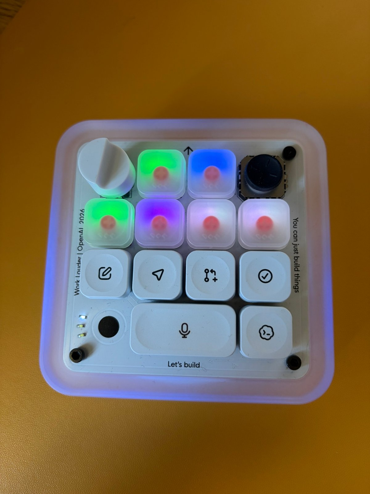

# OpenBoard

A macOS menu-bar app that turns a Work Louder **Codex Micro** into a status board for
your AI coding agents. Each agent session gets one of the six Agent keys, lit by what it
is doing — working, waiting on you, finished — and pressing the key takes you straight to
that chat.

<p align="center">
  
</p>

Works with **Claude Code** (Terminal, iTerm2, cmux, Warp, VS Code, the Claude desktop
app), **T3 Code** and **Cursor**, side by side on the same board.

> [!IMPORTANT]
> Unofficial and experimental. It drives the pad over a private HID protocol that a
> ChatGPT, Work Louder or firmware update can change. Not affiliated with OpenAI,
> Anthropic, Work Louder, T3 or Cursor.

## What the keys mean

| Key | Meaning |
|---|---|
| **Blue**, breathing | working — a turn is running |
| **Orange**, breathing | **waiting on you** — a permission prompt or a question |
| **Purple** | turn finished, but work it started is still running: a CI watch, a dev server, a background agent |
| **Green** | finished, and you have not been back yet. Holds until you return |
| **Red** | the turn failed |
| Dim | session open, nothing running |
| Free | no session on this key |

Every colour, effect and brightness is editable in **Settings → Colors**; the photo above
uses white for free keys.

**The ring** is for across the room. By default it stays dark and fires on transitions:
a green lap when a chat finishes, an orange lap when one stops to ask, a red heartbeat
when a turn fails. It can instead show the most urgent state on the whole board
continuously (spinning while anything works), hold one colour, or stay off, and it spins
a rainbow while you dictate.

## Where sessions come from

| Agent | How it reports | Pressing its key |
|---|---|---|
| **Claude Code** in Terminal, iTerm2, cmux, Warp | hooks in `~/.claude/settings.json`, installed by the app | jumps to the exact tab or pane |
| **Claude Code** in VS Code | the same hooks | reveals the panel holding that chat; the integrated terminal only raises VS Code |
| **Claude desktop app** (Code tab) | the same hooks | opens that chat; archiving it frees the key |
| **T3 Code** | polls T3's local server with a token | opens that thread |
| **Cursor** (Agents window) | Cursor runs Claude Code's hooks for its own chats | opens that chat |

Hermes Agent and Pi are described too, with their gaps stated: Hermes has no completion
event and Pi no approval event. Subagents, child threads and cloud sessions never take a
key, by design — one fan-out would fill the board.

## More sessions than keys

Sessions that do not fit **wait, they are not dropped**. The menu bar lists them under
"Not on a key", and a freed key is refilled from that list. A full board only gives way
to something more urgent: a session waiting on you takes any key that is not, and a
working session takes a finished one after ten minutes.

Keys keep **session order**: closing a session or settling a thread shifts later ones up
to close the gap, and finishing a turn never reorders anything. From the menu you can put
a waiting session on a key by hand (it is then pinned) or take one off (it stays off until
it next needs you).

## Without the pad

The menu bar icon is a status board on its own. It shows one mark per session in the same
colours as the keys, whether or not the pad is connected, so it still works away from the
desk. Square marks mean the pad is live; round ones mean it is away or asleep. With no
session running it folds to a single mark.

The menu follows suit: with the pad it lists the six keys, without it a plain list of
sessions. Clicking a row jumps to that session either way.

## The other keys

Every key is bindable in **Settings → Board**, the six Agent keys included, along with the
keycap icon the menu shows for it. Actions include:

- **approve / reject** the pending prompt — refused whenever OpenBoard cannot confirm
  which chat is in front of you, rather than sending ⏎ at whatever is there
- **custom keyboard shortcut**, **send ⏎**, **type a snippet**
- **dictation** by tap, hold or toggle, with the ring showing while you dictate. It can
  follow the system mic or Handy, so it stays right when dictation is started or stopped
  from the keyboard
- **go back** to the window you were in before the last jump; **next / previous session**
- new Terminal or cmux tab, arrows, tab switching, repaint, all keys off, open the menu

By default the dial opens the menu on a press and Settings on a long press. Lights go off after ten
minutes with no activity (adjustable, never while a key is orange); any press wakes them.

## Requirements

- macOS 14 or later, Apple Silicon or Intel
- A Work Louder Codex Micro (or Creator Micro 2), paired over Bluetooth or USB, **on
  Layer 1** — per-key status renders only there
- To build: the Command Line Tools with the **macOS 26 SDK**. No Xcode, no Apple
  Developer account

Neither the ChatGPT app nor Work Louder's Input app is needed. If the ChatGPT app is
running it repaints these LEDs on its own schedule; OpenBoard reclaims them within about
ten seconds.

## Install

There is no packaged release. Build it:

```sh
git clone https://github.com/tiliakoos/openboard
cd openboard
mac/tools/bootstrap.sh
```

`bootstrap.sh` creates a local signing certificate (so permission grants survive
rebuilds), builds, installs to `/Applications/OpenBoard.app` and opens it. The app has no
Dock icon; it lives in the menu bar and walks you through setup:

| | |
|---|---|
| **Input Monitoring** | reading the pad: every light and key press. Takes effect after a restart |
| **Accessibility** | shortcuts, ⏎ and ⎋, snippets, the dial. Also needs a restart |
| **Automation** | System Events for key actions; Terminal, iTerm2 and others are asked on first use |
| **Key order** | confirms which physical key is slot 1 |
| **Claude Code hooks** | merged into `~/.claude/settings.json`, backed up first, other tools' hooks kept |

Hooks are read when a session starts, so open a new Claude Code session to see a key
light. For T3 Code, open **T3 Code** in Settings' sidebar and save a token (the pane gives
the command that mints one). Turn on **Open OpenBoard at login** in Settings → Device.

## Updating

```sh
git pull && mac/tools/reload.sh
```

There is no update check and nothing phones home. `reload.sh` rebuilds and replaces the
app in place, which keeps permissions, the login item and hook paths working.

## Uninstall

1. Quit OpenBoard and delete `/Applications/OpenBoard.app`
2. Remove the hooks whose command is `…/OpenBoard.app/Contents/MacOS/openboard-hook` from
   `~/.claude/settings.json` — otherwise every session tries to run a binary that is gone
3. Optionally delete `~/Library/Application Support/OpenBoard/`

## Where things are kept

| | |
|---|---|
| `~/Library/Application Support/OpenBoard/` | settings, colours, calibration, T3 token (plain JSON) |
| `~/Library/Logs/OpenBoard/app.log` | what the app saw and did — where every diagnosis starts |

The log contains session names and working-directory paths. It never leaves the machine,
but check it before pasting it anywhere.

## Fun mode

One action plays a video full-screen and drives the pad in time with it. The video is not
included; the beat map for Europe's *The Final Countdown* is. See
[the-final-countdown](the-final-countdown/) for setup and for mapping your own songs.

## Development

A SwiftPM package in `mac/`, built without Xcode. The inner loop is `mac/tools/reload.sh`;
tests are `swift run OpenBoardTests`. [CLAUDE.md](CLAUDE.md) covers the architecture and
the hardware gotchas, [DEVELOPMENT.md](DEVELOPMENT.md) building, testing and the
simulated pad.

## Credits

OpenBoard began as [camwilso/openboard](https://github.com/camwilso/openboard) by **Cam
Wilson**: the original idea, the protocol work against this pad, and the app up to its
0.3.0. This repo split from it in November 2026 and is maintained by **Nick T.**

The HID transport was first published by [@pejmanjohn](https://github.com/pejmanjohn) in
[`codex-micro-light`](https://github.com/pejmanjohn/codex-micro-light).
A few vendor marks identify the agents in Settings. Details in [THIRD-PARTY-NOTICES.md](THIRD-PARTY-NOTICES.md) and
[VENDORED.md](VENDORED.md).

## License

[MIT](LICENSE) — Copyright © 2026 Cam Wilson and Nick T.
